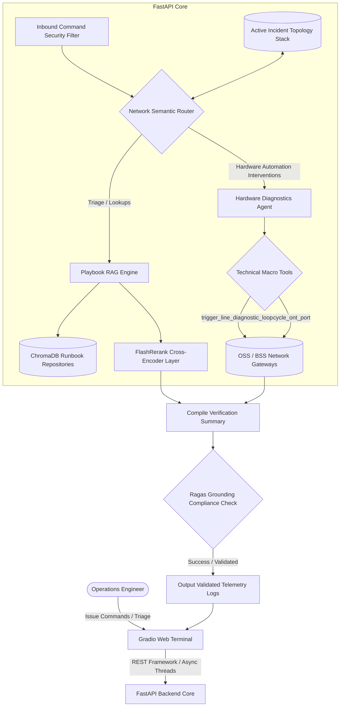
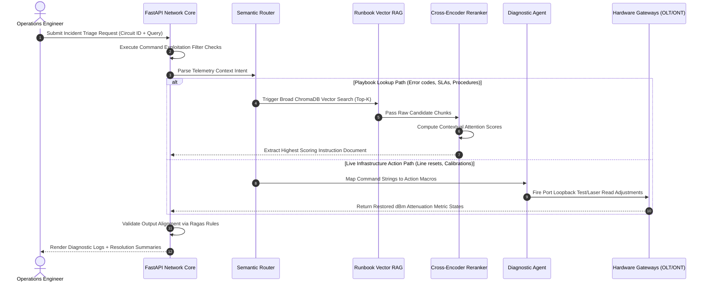

# 🛰️ Enterprise Telecom Network Triage & Incident Engine

A production-grade, secure, multi-agent AI architecture engineered for telecom Network Operations Centers (NOC). The platform integrates **FastAPI** as a high-performance backend core, **Gradio** as an operational frontend UI, semantic routing, **two-stage vector + cross-encoder reranking retrieval**, infrastructure tool calling, and input/output validation guardrails.

---

## 🏗️ System Architecture Diagram



---

## ⚡ Dynamic Diagnostic Sequence Flow



---

## ⚙️ How FastAPI and Gradio Work Together

*   **FastAPI Backend Core**: Acts as the architectural server engine. It leverages asynchronous programming (`async/await`) and performance-optimized validation layers to expose high-throughput endpoints. It processes business rules, runs database migrations, and exposes clean REST endpoints.
*   **Gradio Frontend Web UI**: Eliminates the need to construct multi-layered JavaScript, React, or CSS configurations for internal administrative usage. It builds responsive components (like streaming chat boxes or configuration sliders) natively in Python.
*   **The Mounted Integration**: Instead of running two independent applications on separate network ports, the framework mounts Gradio directly into the active FastAPI instance pipeline using `gr.mount_gradio_app()`. Incoming chat actions cross threading thresholds smoothly, processing real-time telemetry inputs without cross-origin policy blockades.

---

## 🔍 Code Section In-Depth Breakdown

### 🛡️ Section 1 & 4: Authentication Gate & Data Validation
*   **Security Injection Layer**: Integrates dependency-injected security handlers using `APIKeyHeader`. Incoming external microservices must present a secure header key token (`X-Network-Token`) before runtime operations can execute.
*   **Pydantic Data Schemas**: The `SupportRequest` schema acts as a data firewall. It parses structure properties, checking that parameters like `circuit_id` or `diagnostic_query` strictly align with expectations, throwing instant automated `422 Unprocessable Entity` errors if bad input types are intercepted.

### 🗄️ Section 2 & 3: Local Vector Databases & Two-Stage Reranking
*   **Stage 1 - Coarse Vector Search**: Initializes a local in-memory vectorized repository using ChromaDB and the `all-MiniLM-L6-v2` tokenizer model to pull a wide pool of candidate playbooks (`n_results=3`).
*   **Stage 2 - Cross-Encoder Reranking**: Integrates a local, CPU-optimized transformer model via `FlashRerank` (`ms-marco-MiniLM-L-6-v2`). It calculates the context relationship between your query and the raw document text blocks, filtering out weak options and moving the high-confidence directive straight to the top of your prompt context budget.

### 🛠️ Section 5: Asynchronous PostgreSQL Persistence
*   **Relational Storage Topology**: Replaces unstable mock memory dictionaries with a dedicated, isolated PostgreSQL container database layer. Telemetry rows are queried, modified, and committed using asynchronous `SQLAlchemy 2.0` and `asyncpg` execution channels.

### 🧠 Section 6 & 7: Semantic Router, Firewalls, and HTTPX Piping
*   **Malicious Inbound Filter**: Intercepts string payloads to isolate common system exploitation vectors (e.g., catching commands like `sudo rm` or `format nvram`).
*   **Decoupled Network Piping**: Because Gradio components process tasks inside separate background thread pools, they cannot share active SQLAlchemy database loops. The application solves this by using an internal `httpx` network client—Gradio forwards prompts as real network calls to the backend API gateway on port `8000`, ensuring database transactions stay perfectly bound to isolated, thread-safe request lifecycles.

---

## 📦 Getting Started

### 1. Installation Requirements
```bash
pip install fastapi uvicorn chromadb pydantic gradio sqlalchemy asyncpg httpx flashrerank
```

### 2. Launch the Multi-Container Infrastructure Stack
```bash
docker compose up --build -d
```

### 3. Verification Testing Gateways
*   **Interactive Web Chat Dashboard**: Open your web browser and target `http://localhost:8000/`.
*   **Automated OpenAPI Playground**: Open a browser tab to `http://localhost:8000/docs` to examine your JSON schema layouts and perform code tests against live endpoints.
