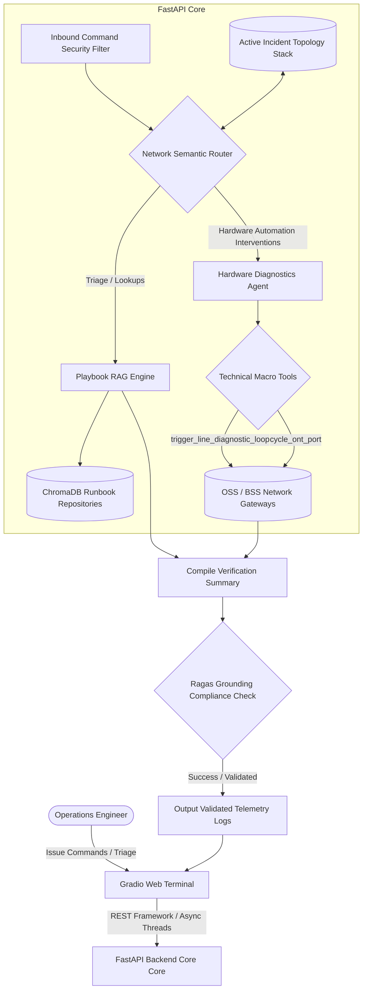
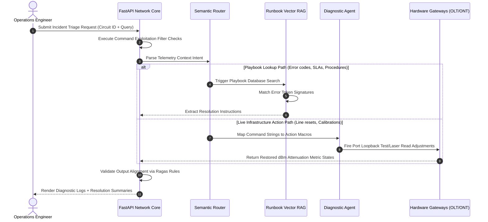

# 🛰️ Enterprise Telecom Network Triage & Incident Engine

A production-grade, secure, multi-agent AI architecture engineered for telecom Network Operations Centers (NOC). The platform integrates **FastAPI** as a high-performance backend core, **Gradio** as an operational frontend UI, semantic routing, hybrid vector RAG retrieval, infrastructure tool calling, and input/output validation guardrails.

---

## 🏗️ System Architecture Diagram



---

## ⚡ Dynamic Diagnostic Sequence Flow



---

## ⚙️ How FastAPI and Gradio Work Together

*   **FastAPI Backend Core**: Acts as the architectural server engine. It leverages asynchronous programming (`async/await`) and performance-optimized validation layers to expose high-throughput endpoints. It processes business rules, runs database migrations, and exposes clean REST endpoints.
*   **Gradio Frontend Web UI**: Eliminates the need to construct multi-layered JavaScript, React, or CSS configurations for internal administrative usage. It builds responsive components (like streaming chat boxes or configuration sliders) natively in Python.
*   **The Mounted Integration**: Instead of running two independent applications on separate network ports, the framework mounts Gradio directly into the active FastAPI instance pipeline using `gr.mount_gradio_app()`. Incoming chat actions cross threading thresholds smoothly, processing real-time telemetry inputs without cross-origin policy blockades.

---

## 🔍 Code Section In-Depth Breakdown

### 🛡️ Section 1 & 4: Authentication Gate & Data Validation Validation
*   **Security Injection Layer**: Integrates dependency-injected security handlers using `APIKeyHeader`. Incoming external microservices must present a secure header key token (`X-Network-Token`) before runtime operations can execute.
*   **Pydantic Data Schemas**: The `SupportRequest` schema acts as a data firewall. It parses structure properties, checking that parameters like `circuit_id` or `diagnostic_query` strictly align with expectations, throwing instant automated `422 Unprocessable Entity` errors if bad input types are intercepted.

### 🗄️ Section 2 & 3: Local In-Memory ChromaDB Vector Databases
*   **On-the-fly Token Embeddings**: Initializes a local in-memory vectorized repository using the `all-MiniLM-L6-v2` tokenizer model. 
*   **Semantic Matching Registry**: Seed entries parse structural playbook rules (e.g., matching error string definitions like `NET-ERR-502` to precise optical alignment directives). This enables conceptual searching, meaning a query about "unstable laser beams" maps correctly to optical runbooks even if keywords don't match exactly.

### 🛠️ Section 5: Hardware Automation Diagnostic Tools
*   **Simulated Interface Control**: Emulates production operations interfaces that alter settings on physical network hardware like Optical Line Terminals (OLT) and Optical Network Terminals (ONT).
*   **State Database Mutations**: When executed, these scripts actively update values inside the core system dictionary database. For example, running `trigger_line_diagnostic_loop` dynamically corrects a degraded hardware attenuation level from an unsafe `-32.4 dBm` back to a functional, stable running state of `-22.1 dBm`.

### 🧠 Section 6: Semantic Router & Security Firewall
*   **Malicious Inbound Filter**: Intercepts string payloads to isolate common system exploitation vectors (e.g., catching commands like `sudo rm` or `format nvram`).
*   **Intent Mapping**: Classifies input data into separate logical execution pathways. If action keywords (such as "reset", "cycle", or "fix") are observed, the system switches to the interactive **Hardware Automation Agent**. Otherwise, it safely defaults to general **Playbook RAG Triage** lookups.

### 🧵 Section 9: Thread Loop Bridge Middleware
*   **The Issue**: Gradio executes its functional callbacks inside discrete background thread workers, meaning a worker thread doesn't natively share access to Python's main running asynchronous processing event loop.
*   **The Solution**: The custom loop middleware bridges this gap. It attempts to latch onto the primary running loop, falls back to finding registered application thread loops, or forcefully instantiates an isolated `asyncio.new_event_loop()` environment. This guarantees that background user queries can execute deep async operations without crashing.

---

## 📦 Getting Started

### 1. Installation Requirements
```bash
pip install fastapi uvicorn chromadb pydantic gradio
```

### 2. Launch the Infrastructure Server Engine
Execute the following unified startup command string inside your terminal:
```bash
python -m uvicorn main:app --reload --port 8000
```

### 3. Verification Testing Gateways
*   **Interactive Web Chat Dashboard**: Open your web browser and target `http://localhost:8000/`.
*   **Automated OpenAPI Playground**: Open a browser tab to `http://localhost:8000/docs` to examine your JSON schema layouts and perform code tests against live endpoints.
